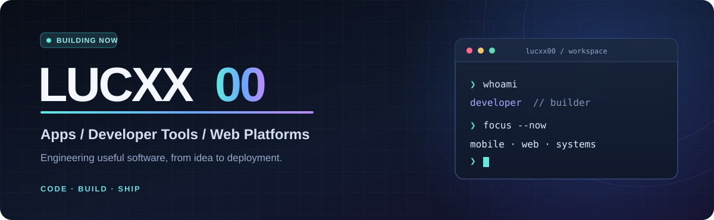

<div align="center">
  

  <p></p>

  <h3>Hey, I'm Lucxx00 👋</h3>
  <p>I design and build mobile apps, web platforms, and performance-focused developer tools.<br/>
  I care about clean interfaces, reliable architecture, and turning ideas into working software.</p>

  <a href="https://github.com/Lucxx00"></a>
  
</div>

---

### ⚡ What I build

- **Mobile products** — cross-platform app experiences, training workflows, and backend integrations.
- **Developer tools** — Windows utilities, system tooling, and performance-focused software.
- **Web platforms** — responsive products, APIs, deployment pipelines, and automation.

### 🚀 Selected work

| Project | Focus | Stage |
| --- | --- | --- |
| **REPRYX** | Fitness and coaching mobile app focused on intuitive UX and reliable training flows | In development |
| **Innovatech Hub** | Windows tools for productivity, gaming performance, and system management | In development |
| **SitoLab AI** | AI-assisted website creation platform and supporting infrastructure | In development |
| **Web experiences** | Modern client websites, e-commerce, responsive interfaces, and integrations | Selected projects |

> Some projects are private or not yet released. Public demos and technical case studies will be linked here when available.

### 🧰 Tech stack

**Languages**


**Apps & web**


**Infrastructure & data**


### 🎯 Currently focused on

```text
> shipping polished products
> improving UI/UX and performance
> automating development & deployment
> learning by building real things
```

### 📬 Connect

Want to explore the work, share feedback, or collaborate? Find me on **[GitHub](https://github.com/Lucxx00)**.

<sub>Built with care — not just another badge wall.</sub>
